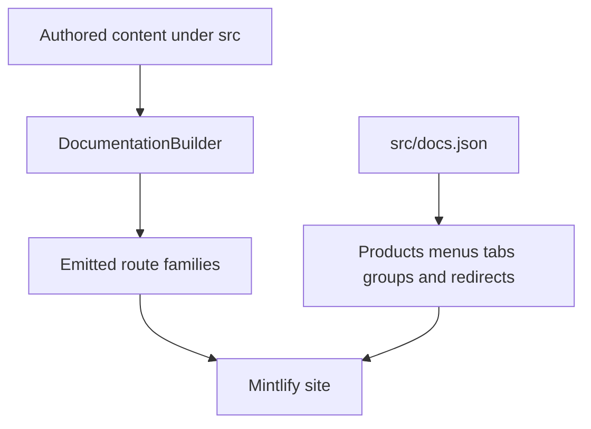

`src/` is the authored documentation tree, but it is not the site map. Two independent authorities must agree:

- `pipeline/core/builder.py` owns **route emission**: it selects files, makes language variants, applies conditional-content preprocessing, and rewrites language-sensitive imports and links.
- `src/docs.json` owns **Mintlify navigation and redirects**: it places emitted routes under products, menu items, tabs, and groups, and preserves moved public URLs.

Do not infer either contract from a directory name alone. For example, `src/langsmith/fleet/` retains the `fleet` route segment but is labeled **No-code agents** in the UI; `src/oss/deepagents/code/` is a product surface rather than part of the language-versioned Deep Agents SDK.

This diagram shows the ownership boundary: the builder creates route files, while `docs.json` makes routes discoverable and redirects legacy URLs.

## Source-to-route ownership

| Authored domain | Emitted route family | Navigation placement |
| --- | --- | --- |
| `src/oss/python/` | `/oss/python/...`; the source `python/` segment is removed | Build → Python dropdown |
| `src/oss/javascript/` | `/oss/javascript/...`; the source `javascript/` segment is removed | Build → TypeScript dropdown |
| Shared OSS, including `src/oss/langchain/`, `src/oss/langgraph/`, and `src/oss/deepagents/` except `code/` | Both `/oss/python/...` and `/oss/javascript/...` | Build language dropdowns |
| `src/oss/openwiki/` | `/oss/openwiki/...` once | Build → OpenWiki in both dropdowns |
| `src/oss/deepagents/code/` | `/oss/deepagents/code/...` once | Products and setup → Deep Agents Code |
| Ordinary `src/langsmith/` content, including `fleet/` | `/langsmith/...` | A Lifecycle or Products and setup position selected in `docs.json` |
| Direct `src/langsmith/managed-deep-agents*.mdx` | Both `/langsmith/python/...` and `/langsmith/javascript/...` | Build → Managed Deep Agents |
| `src/snippets/` | Imported reusable content, not public page routes | Referenced from MDX |
| `src/docs.json`, images, fonts, root CSS/JavaScript | Copied shared inputs | Mintlify configuration is `docs.json` |

Most authored OSS content is emitted as separate Python and TypeScript route trees: `/src/oss/python/` and `/src/oss/javascript/` are included only in their matching output, while shared OSS directories such as `/src/oss/langchain/`, `/src/oss/langgraph/`, and `/src/oss/deepagents/` are built for both languages with conditional fences resolved per target. Author shared language-dependent prose with `:::python` and `:::js` rather than duplicating a page only for fenced content.

OpenWiki and Deep Agents Code are the two OSS exceptions to language duplication: `/src/oss/openwiki/` builds once at `/oss/openwiki/...` and `/src/oss/deepagents/code/` builds once at `/oss/deepagents/code/...`, both using the Python conditional-content branch. The OSS link rewriter keeps those unversioned product roots intact; a bare link to other OSS material receives the current language prefix.

## Navigation is a configuration contract

Directory structure constrains URL routes, but directory names do not perfectly mirror navigation labels; for example, `/src/langsmith/fleet/` maps to 'No-code agents' in the navigation UI. A move is complete only after its source MDX, exact `docs.json` placement, and any needed redirect are updated.

- **AGENT DEVELOPMENT LIFECYCLE** contains Home, Build, Test, Deploy, and Monitor. Build has Python and TypeScript dropdowns with ten tabs each; Test, Deploy, and Monitor have LangSmith tabs without a language split.
- **PRODUCTS AND SETUP** contains LangSmith setup, LLM Gateway, No-code agents, Engine, and Deep Agents Code. LangSmith setup is tabbed; the other items are direct pages and/or page groups.

Test, Deploy, and Monitor menu items draw from files flat in `/src/langsmith/` organized by functional topic without directory structure constraints. Their position comes from the corresponding tab and group in `docs.json`, not from a source subdirectory.

### LangSmith setup

**LangSmith setup** has six tabs: Overview, Account, Cloud, BYOC, Self-hosted, and Govern. It maps a broad but flat `src/langsmith/` source surface into hosting, administration, billing, and governance tasks:

- **Account** contains account and plan pages plus a **Billing & usage** group; `billing.mdx` is therefore an account-management route, not a standalone product menu.
- **BYOC** groups the direct `byoc*.mdx` routes (overview, rationale, architecture, shared responsibility, onboarding, BYOVPC, migration, usage, operations, billing, and FAQ).
- **Self-hosted** is grouped by deployment path and operational responsibility, including Terraform per cloud, installation management, configuration, external services, platform access control, observability, hybrid operation, scripts, and reference material.
- **Govern** groups organization setup, users and access control, tools, auditing, data and compliance, and FAQ/status resources. `administration-overview.mdx` is the organization entry point: organizations contain workspaces, workspaces isolate resources and access control, and applications organize tagged resources within a workspace.

BYOC is a flat LangSmith setup source surface: its overview, architecture, onboarding, and FAQ pages are direct src/langsmith files at the corresponding /langsmith/byoc... routes, while docs.json places them in the BYOC setup tab. The architecture divides responsibility between a LangChain-cloud control plane for authentication, organization configuration, billing, and orchestration, and a customer-AWS data plane for sensitive application data and infrastructure. Onboarding creates the data plane through `Requested` → `Provisioning` → `Active`; `Provisioning Failed` requires support, and each workspace is permanently assigned to one data plane.

### Other Products and setup surfaces

**LLM Gateway** is a Beta Products and setup item sourced from flat `src/langsmith/llm-gateway*.mdx` files. Its navigation separates Core capabilities, Administration and governance, and Advanced; credits are in the first group and model-access policies in the second. The landing route describes the operating boundary: an administrator enables the gateway, adds a provider secret, and grants workspace access before developers send supported API-format calls with a workspace-scoped LangSmith API key. Model IDs choose a configured provider or Gateway Credits route, while calls are traced and governed centrally. Model-access policies return `403` for blocked providers or models; the most-specific scope supersedes broader scopes and policies at the same scope intersect.

**No-code agents** is the UI label for Fleet. Content stays in `src/langsmith/fleet/`, emits `/langsmith/fleet/...`, and is grouped as Get started, Configure, Tools and automation, Advanced, and Additional resources. Keep this directory boundary even though its neighboring product content is largely flat.

**Engine** is a flat `src/langsmith/engine*.mdx` surface with direct navigation for overview, issue workflow, GitHub integration, issue categories, webhooks, security, and self-hosted operation. The overview describes a closed loop from recurring trace issue, through diagnosis and proposed fix, to tracking new matching traces and reopening a closed issue if it recurs.

**Deep Agents Code** is an unversioned Products and setup surface. Its expanded **Configuration** group is rooted at `oss/deepagents/code/configuration` and contains credentials, config file, hooks, and MCP tools. The configuration landing page is the authoritative routing entry for distinct resolution orders: general options, provider keys, dotenv files, and provider endpoints. It captures `DEEPAGENTS_HOME` before dotenv loading so project-controlled dotenv content cannot relocate the trusted profile root; `dcode config` inspection commands report configuration origins without exposing secret values.

## Managed Deep Agents: dual routes from one source

A Managed Deep Agents page is a `.md` or `.mdx` file directly under `src/langsmith/` whose filename starts `managed-deep-agents`. It is excluded from ordinary unversioned LangSmith emission and is instead built once for each language. The Build dropdowns place the resulting variants in the Managed Deep Agents tab, with **Get started**, **Agent capabilities**, and **Build and deploy** groups; the capabilities group includes agent definition, connections, MCP connectors, identity, channels, schedules, and evals.

Files named managed-deep-agents*.mdx in /src/langsmith/ generate language-prefixed routes (/langsmith/python/managed-deep-agents-... and /langsmith/javascript/managed-deep-agents-...) appearing in the Build tab Managed Deep Agents, with unversioned URLs redirecting to the Python routes. Do not create an unversioned content duplicate for a legacy URL; retain or add the redirect in `docs.json`.

The language split is content-significant. For example, the agent definition uses a Python `agent.py` entry with `define_deep_agent`, or a TypeScript `agent.ts` or `agent.tsx` entry with `defineDeepAgent`. Connections preserve credentials in the LangSmith workspace and resolve them at runtime by slug and owner: an agent-owned credential is deployment-specific, while a user-owned credential is resolved against the authenticated caller. Missing agent credentials fail a run; missing user credentials request authorization through a `credential_authorization_required` interrupt.

## Builder transformation and safety invariants

For each target language, the builder preprocesses MDX, rewrites versioned snippet imports, rewrites unqualified OSS links unless they are already language-qualified or belong to an unversioned OSS product, and rewrites unversioned Managed Deep Agents links to the target-language route. This ordering makes imports and intra-site links resolve from both emitted language trees.

The build entrypoint clears and recreates the build directory, emits Python and JavaScript OSS variants, then unversioned Deep Agents Code, OpenWiki, and ordinary LangSmith content, followed by Managed Deep Agents variants and shared files. Template MDX is skipped. File collection rejects source-tree symlinks and files whose resolved path escapes the collection root, preventing a committed source path from importing host files into artifacts.

## Safe change checklist

1. Select the source owner from the table; a valid route path does not determine its navigation location.
2. Update the source file and its exact `docs.json` product/menu/tab/group entry. Add a redirect when changing a public URL.
3. For shared OSS and Managed Deep Agents, inspect both language outputs, conditional fences, rewritten snippet imports, and rewritten links. For OpenWiki and Deep Agents Code, ensure no language-prefixed duplicate was emitted.
4. Keep Fleet nested and Deep Agents Code unversioned; visible labels are not a reason to relocate either source.
5. Run `make build` and `make broken-links` after route or link work. Extend builder tests when changing route selection, rewriting, or containment behavior.

Focused builder tests assert the key route boundaries: language-prefix rewriting, one-time unversioned OSS output, dual Managed Deep Agents routes, language-scoped snippet imports, and source-symlink exclusion.

## Related pages

- [Build system architecture](/openwiki/architecture/build-system.md)
- [Versioning](/openwiki/concepts/versioning.md)
- [Mintlify integration](/openwiki/integrations/mintlify.md)
- [Adding pages](/openwiki/operations/adding-pages.md)
- [Quickstart](/openwiki/quickstart.md)
