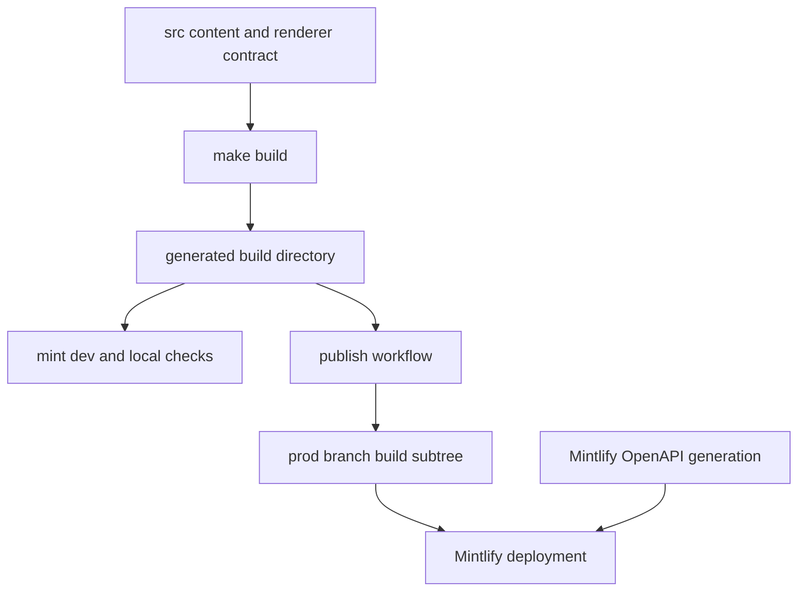

# Mintlify Integration

Mintlify is the renderer and hosting integration for [docs.langchain.com](https://docs.langchain.com). Authors edit `src/`; the pipeline regenerates the disposable `build/` tree that Mintlify consumes. Never patch `build/`: the next build removes it.



This shows the renderer handoff. The pipeline produces local files in `build/`; Mintlify adds configured OpenAPI endpoint routes only at deployment, so those routes are not local builder output.

## Renderer contract and navigation

`src/docs.json` is copied to `build/docs.json` and is Mintlify's site contract. It selects the Aspen theme; logos, colors, appearance, code themes, Tabler icons, fonts, GTM, canonical SEO metadata, header resources, contextual actions, navigation, error behavior, and redirects. It loads `style.css` through `head`; that stylesheet provides additional TWK Lausanne faces, applies Inter to body content, and overrides Mintlify styling. The contextual page-header menu includes `copy` and `view` plus `llms.txt`, ChatGPT, Claude, MCP, Cursor, and VSCode actions.

The builder clears `build/`, produces Python and JavaScript variants for ordinary OSS material, emits LangSmith content, then copies shared inputs such as `docs.json`, assets, fonts, CSS, and JavaScript. Deep Agents Code and OpenWiki are intentional unversioned OSS exceptions; Managed Deep Agents instead has Python and JavaScript output routes. Link rewriting respects those boundaries, so a navigation path must match the output convention for its content.

`navigation.products` owns the product menu. Under **PRODUCTS AND SETUP**, it provides LangSmith setup plus these current product entries:

- **LLM Gateway** (Beta), with overview, quickstart, API-format, capability, governance, and advanced pages.
- **No-code agents**, the LangSmith Fleet documentation grouped by onboarding, configuration, automation, advanced use, and additional resources.
- **Engine**, for issue workflow, GitHub integration, categories, webhooks, security, and self-hosting.
- **Deep Agents Code**, rooted at `oss/deepagents/code/`. Its expanded **Configuration** group has an explicit `root` and includes credentials, config-file, hooks, and MCP-tools pages.

Redirects are also renderer contract. They preserve legacy LLM Gateway paths and direct unversioned Managed Deep Agents URLs to the Python variants, preventing routes that the builder intentionally does not emit from becoming orphaned pages.

## OpenAPI is a deployment boundary

Three navigation groups configure OpenAPI:

- **Agent Server API** uses committed `langsmith/agent-server-openapi.json` with directory `langsmith/agent-server-api`.
- **Control Plane API** uses the remote `https://api.host.langchain.com/openapi.json` specification.
- **LangSmith REST API** uses committed `langsmith/langsmith-platform-openapi.json` with directory `langsmith/smith-api`.

Mintlify generates the configured endpoint pages during deployment. Thus a successful local build does not establish remote Control Plane availability or create the generated routes. The LangSmith REST source is refreshed daily by `scripts/process_langsmith_openapi.py --write`; the workflow updates one existing refresh PR when possible and opens one only when the processed specification changed.

`make check-openapi` runs `mint openapi-check langsmith/agent-server-openapi.json` from `build/`. It validates that committed Agent Server input, not deployment-time rendering or the remote specification.

## Local renderer workflow and checks

`make dev` installs project npm dependencies and runs the pipeline development command. Unless `--skip-build` is supplied, it first builds; it then watches `src/` and runs `mint dev --port 3000` from `build/`. A failed initial build prevents startup. A nonzero Mint exit, watcher cancellation, or watcher exception makes the command fail; interruption shuts down the watcher and child process.

Use the generated-tree checks after changes to links, navigation, snippets, or references:

```bash
make broken-links
make broken-links-with-anchors
make check-openapi
```

The link targets build first, invoke `mint broken-links` in `build/`, and fail only if filtering leaves actionable indented link records. Filtering removes false positives for deployment-generated OpenAPI pages and for snippets examined as standalone files. The reusable CI workflow uses Node 22, installs or restores the global Mint CLI, applies its KaTeX workaround, then runs the anchor check and the Agent Server OpenAPI check.

MDX snippets are not standalone routes: Mintlify expands imports while rendering a consuming page. The builder writes language-specific copies to `build/snippets/{python|javascript}/` and rewrites versioned-page imports to those copies; unversioned consumers retain the Python-default behavior. Builder tests cover language-scoped snippet imports and reject traversal outside the generated snippet directory when page bodies are expanded.

## Offline export

```bash
make export
make htmltest
# or
make export-htmltest
```

`make export` builds first and runs `mint export` from `build/`, producing `build/export.zip` by default. It requires a Mint CLI with export support, Node LTS 20 or 22, and an Enterprise Mintlify plan. `make htmltest` unpacks that archive and checks external URLs, but deliberately disables internal and internal-hash checks because Mintlify export omits pages. It is not proof of internal navigation; use the Mint link checks for that.

## Publication and previews

On a `main` push or manual dispatch, the publication workflow builds, verifies `build/`, copies it to `public/build`, and force-publishes `public` to `prod` with `peaceiris/actions-gh-pages@v4`. Mintlify deploys the generated `build/` subtree from that production branch.

For a same-repository pull request (or a manual run), the preview workflow validates the source branch, builds, creates a collision-resistant `preview-*` branch, force-adds and pushes its `build/` artifacts, then triggers Mintlify's preview API. The trigger requires `MINTLIFY_API_KEY`, `MINTLIFY_PROJECT_ID`, and the produced branch name; missing inputs, malformed JSON, or an API error without a status or preview URL fail the job. On PR closure, cleanup deletes only preview branches matching the sanitized source-prefix pattern.

## Change checklist

1. Change MDX, `src/docs.json`, assets, or `src/style.css` in `src/`, then rebuild; do not edit `build/`.
2. For a route move or new page, reconcile output convention, `docs.json` navigation, and redirects.
3. Inspect with `make dev`, then run `make broken-links-with-anchors`; run `make check-openapi` when changing the Agent Server specification.
4. Treat export validation as external-link coverage only. Validate remote Control Plane and Mintlify-generated OpenAPI routes at deployment.
5. Use the preview workflow before publication when renderer or deployment behavior needs review.

## Related concepts

- [Build system](/openwiki/architecture/build-system.md) — source transformation and generated-tree lifecycle.
- [Source map](/openwiki/architecture/source-map.md) — source paths, URLs, and build output mapping.
- [GitHub Actions](/openwiki/integrations/github-actions.md) — CI, publication, and preview workflows.
- [CLI tools](/openwiki/operations/cli-tools.md) — local command behavior.
- [Test overview](/openwiki/testing/test-overview.md) — repository validation layers.
- [Local development](/openwiki/workflows/local-development.md) — contributor workflow and local preview.
