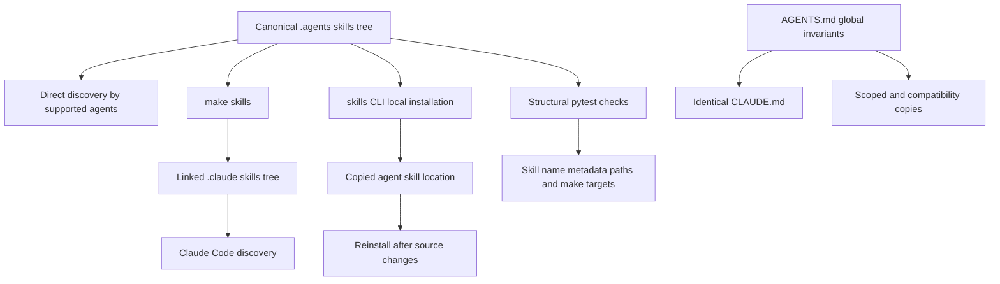

# Agent Authoring Skills

Repository skills are task-specific, on-demand procedures stored in `.agents/skills/`. They make specialized documentation work repeatable without putting every procedure into every agent task. Repository-wide invariants belong in `AGENTS.md` and its byte-identical `CLAUDE.md` counterpart; skill bodies link to those rules instead of copying them.

## Understand the source and distribution model

`.agents/skills/` is the canonical, version-controlled skill tree. Each skill is a directory containing `SKILL.md` in the Agent Skills format: YAML frontmatter, including a discovery `name` and `description`, followed by Markdown instructions. The directory name and frontmatter `name` identify the same skill.

Cursor, Codex, GitHub Copilot, Gemini CLI, OpenCode, Deep Agents, Droid, Kilo Code, and other supported agents discover this tree directly after a clone. Claude Code is the exception: it reads the gitignored `.claude/skills/` location. Run the following command once, and again after a pull that adds or renames a skill:

```bash
make skills
```

The target creates `.claude/skills/` as needed, symlinks each canonical skill directory into it, preserves personal non-symlink entries, and removes a symlink whose source no longer exists. Because this is a link rather than a copy, edits to `.agents/skills/` are live in Claude Code. For an agent with another skill location, use the `skills` CLI to copy the local source. Its update command does not refresh local-source copies, so rerun the install command after source changes or use symlinks.



This diagram shows canonical skill discovery, linked and copied distribution paths, and the independent contracts that keep skills and global instructions usable.

### Maintain canonical and derived instruction surfaces

`AGENTS.md` is the authoritative repository guide for universal constraints and orientation, including critical editing rules, repository layout, frontmatter and syntax conventions, navigation guidance, and the skill inventory. `CLAUDE.md` is a compatibility surface, not an alternative policy source. The `check-agents-sync` workflow runs on pull requests and pushes to `main` when either root guide changes, and fails when `diff` finds any difference.

Several files derive from the root guide for tools that do not consume it directly:

- `.cursor/rules/docs-style.mdc` and `.github/instructions/docs-style.instructions.md` mirror the style-guide portion and are scoped to `src/**/*.mdx` edits.
- `.cursorrules` and `.github/copilot-instructions.md` summarize critical rules, repository structure, quick reference, frontmatter, and syntax.
- `.claude/skills/` is a local linked distribution surface, not a second skill source.

When changing a covered root-guide section, update its listed copies in the same pull request. The CI sync job enforces only the root-file pair. It does not prove that summaries and path-scoped style copies are current. Do not add another copy of global guidance to a skill.

## Keep invariants separate from procedures

Always-on instruction files consume context for every task. A skill initially exposes its `description` for matching, then loads its body when invoked. Put universal constraints in `AGENTS.md` and `CLAUDE.md`; give a skill one conditional workflow with its decisions, tool use, ordering, and verification.

| Put it in | Content | Example responsibility |
| --- | --- | --- |
| `AGENTS.md` and `CLAUDE.md` | Rules that apply to every edit | Do not edit generated output, preserve required frontmatter, and use the navigation map. |
| `.agents/skills/<name>/SKILL.md` | A focused, conditional procedure | Edit an open PR, draft prose, add a page, or record tooling in Notion. |
| A scoped or compatibility instruction copy | A derived view for an agent or file scope | Load prose-style rules only while editing MDX. |

A skill should point readers to the root guide for shared policy, then supply the task-specific information missing there. For example, `add-docs-page` uses the root guide for navigation, style, and frontmatter rules, then owns the page lifecycle and invokes `docs-review` after finished prose. `docs-team-voice` addresses non-mechanical prose decisions, while `docs-tooling-notion` delegates shared voice rules rather than restating them. This boundary limits drift and makes the always-on context useful across tasks.

## Choose the matching procedure

The current tree divides work into the following task boundaries. The skill names are canonical directory and frontmatter names.

| Skill | Use it when | Important handoff or boundary |
| --- | --- | --- |
| `add-docs-page` | Adding, moving, renaming, or deleting a page | Owns navigation, redirects, and validation; invokes `docs-review` only after prose is complete. |
| `docs-edit` | Editing a page on an existing PR, a named branch, or in place | Works on the PR head branch rather than creating a competing branch; use `add-docs-page` for lifecycle changes. |
| `docs-team-voice` | Drafting or revising documentation prose | Covers voice and revision choices that a linter cannot decide; use `docs-review` for the diff-scoped review. |
| `docs-review` | Reviewing changed documentation prose | Resolves a PR, branch, or working-tree diff, runs Vale, and reports applicable rule-based findings. |
| `docs-tooling-notion` | Documenting changed team tooling in Notion | Routes a topic to one owning page and performs narrow Notion MCP updates; the repository skill remains its authoritative procedure. |
| `docs-code-samples` | Moving inline MDX examples to runnable sample files | Owns snippet markers, extraction, and sample-testing constraints. |
| `submit-integration` | Turning a structured integration issue into listing changes | Runs non-interactively inside the maintainer-gated workflow and leaves changes for the workflow to turn into a PR. |
| `update-integrations-prs` | Reconciling an existing integration PR with policy | Handles PR maintenance, distinct from new issue intake. |

`docs-edit` prevents a common collaboration failure: edits requested on an open PR must land on that PR's head branch. It checks out the tracked branch for same-repository PRs, uses `gh pr checkout` for forked PRs, and prefers `gh pr diff` to a potentially stale local-base comparison. Do not create a new branch unless the request and ownership warrant it.

`docs-team-voice` complements the root guide rather than replacing it. It gives authors measurable drafting and revision guidance, such as splitting long sentences, linking first mentions, stating defaults and constraints directly, using exact identifiers, and cutting unverified claims or filler. Run `make lint_prose` after the revision pass; use `docs-review` when a review report is needed.

`docs-tooling-notion` treats the five Docs Team Notion pages as routing destinations with one home per topic. It first checks whether the repository already owns the material, then fetches the selected Notion page before applying narrow `update_content` replacements through the Notion MCP server. Fetch again after a timed-out or asynchronous update before retrying, because the update may already have applied. Avoid `replace_content` on a page with uploaded images, because rewriting can break a short-lived signed image URL.

Deep Agents resolves `submit-integration` from `.agents/skills/` at higher precedence than the former `.deepagents/skills/` location. The integration-submission workflow asks for this skill only after a maintainer-authorized issue event and parsed issue-form JSON; it treats those fields as untrusted metadata. The workflow, not the skill, handles blockers, no-change results, and pull-request creation. The skill is therefore a constrained procedure within a GitHub Actions trust boundary, not a general permission to mutate GitHub.

For related operational flows, see [Adding and Modifying Documentation Pages](/openwiki/operations/adding-pages.md), [CLI Tools](/openwiki/operations/cli-tools.md), [Quickstart](/openwiki/quickstart.md), [Testing Overview](/openwiki/testing/test-overview.md), and [Integration Listing Automation](/openwiki/workflows/integration-listing-automation.md).

## Add or change a skill safely

Create `.agents/skills/<name>/SKILL.md`. Use a kebab-case verb-noun directory name and make frontmatter `name` exactly match it. Write `description` in the language of a user request because it is the discovery signal. Keep the body to one cohesive workflow, and split unrelated procedures rather than creating branches for them.

Use supported frontmatter keys only. `description` is required and must contain at most 1,024 characters. Paths and `make` targets named by a skill must stay valid, because agents can act on a stale procedure with confidence. Validate the canonical tree, not the Claude symlink path:

```bash
claude plugin validate .agents/skills --strict
```

The validator does not follow the Claude symlinks, so validating `.claude/skills` warns rather than checking the real contracts. After adding or removing a skill, update both the `.agents/skills/README.md` inventory and the `AGENTS.md` Skills table. Update `CLAUDE.md` identically with `AGENTS.md`.

## Validate contracts and diagnose failures

`tests/unit_tests/test_skills.py` provides repository-level structural validation. It discovers each child directory in the canonical tree and checks these contracts:

- Every directory has a `SKILL.md` with parseable YAML frontmatter, a matching kebab-case name, a nonempty bounded description, and no unrecognized frontmatter keys.
- Backticked paths under known repository roots and selected root files exist unless they are recognized placeholders, globs, variable expressions, home-directory paths, or gitignored paths.
- Every `make <target>` named by a skill is defined in the root `Makefile`.
- The README and `AGENTS.md` tables list exactly the skills that exist as directories.

Run the focused test while changing skill contracts:

```bash
make test TEST_FILE=tests/unit_tests/test_skills.py
```

A frontmatter failure usually means a missing `SKILL.md`, mismatched name, malformed YAML, unsupported key, or absent description. A path or make-target failure means that a procedure points at a renamed or removed repository interface; correct the procedure rather than weakening the check. A table mismatch means agents may discover the skill while the human and global-instruction inventories are stale. Repair those catalogues in the same change. Run `make skills` locally when Claude Code distribution also needs verification.

## See also

- [Quickstart](/openwiki/quickstart.md)
- [Adding and Modifying Documentation Pages](/openwiki/operations/adding-pages.md)
- [CLI Tools](/openwiki/operations/cli-tools.md)
- [Testing Overview](/openwiki/testing/test-overview.md)
- [Integration Listing Automation](/openwiki/workflows/integration-listing-automation.md)
