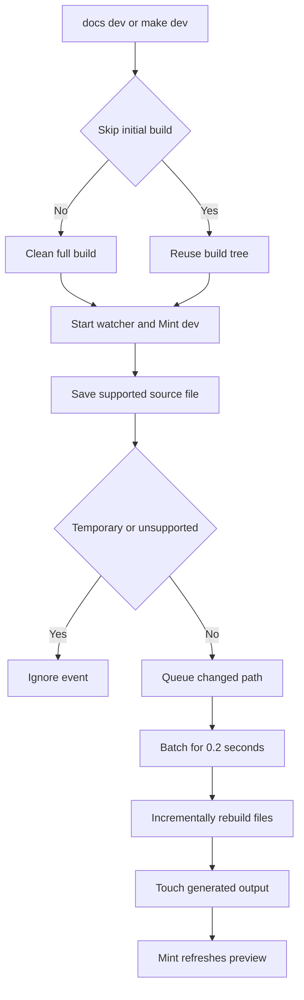

# Local Development Workflow

Author documentation, navigation, and assets in `src/`. The pipeline creates the Mintlify-facing `build/` tree, which is disposable and must not be edited: a full build removes and recreates it.

## Install the local toolchain

The checkout requires Python 3.13 or later, Node.js, and `uv`. Install all Python dependency groups, local npm packages, the global Mintlify CLI, and the agent-skill links:

```bash
git clone https://github.com/langchain-ai/docs.git
cd docs
make install
```

`make install` runs `uv sync --all-groups`, `npm install`, and `npm install -g mint@latest`. It also links `.agents/skills/` for Claude Code. The Python project installs the preferred `docs` CLI. If the command is not available after installation, relaunch the shell or activate the virtual environment. Mint is a separate global executable; check it with `mint --version`.

## Choose the correct command layer

Use the Python `docs` CLI for direct documentation-pipeline work. The Make targets are checkout-facing wrappers that install local npm dependencies, set `PYTHONPATH`, and invoke the pipeline. Use `mint` only for renderer operations against generated output.

```bash
# Preferred direct pipeline entrypoints
docs dev
docs build

# Checkout wrappers
make dev
make build

# Module entrypoint used by Make
uv run pipeline dev
uv run pipeline build
```

`docs dev`, `make dev`, and `uv run pipeline dev` start development mode. `docs build`, `make build`, and `uv run pipeline build` perform one clean full build and exit. Although the parser accepts `docs build --watch`, `build_command` does not inspect that option, so it still builds once and returns. Use `docs dev` for supported watching.

## Run the edit-preview loop

Start the normal loop with either `docs dev` or `make dev`:

```bash
make dev
```

Unless `--skip-build` is set, development mode builds the complete documentation tree first. It then watches `src/` recursively and starts `mint dev --port 3000` from `build/`. Open <http://localhost:3000> and review the rendered route, navigation, formatting, and links.



This shows the normal development lifecycle: the initial full build establishes a coherent generated tree, then focused watcher updates feed the local Mint preview.

### Handle startup, failure, and shutdown

Without `--skip-build`, a failed initial build returns exit code 1 before the watcher or Mint starts. `docs dev --skip-build` deliberately reuses the existing `build/` directory and only warns if it is absent. Use it after a short interruption only when the existing output is appropriate; use a normal development start or a full build after structural changes.

If `mint` cannot be started, development exits 1 and reports how to install it. After startup, a nonzero Mint exit, a cancelled watcher, or an unexpected watcher stop also makes the command fail. Mint stdout is forwarded as informational logs and stderr as error logs.

Press Ctrl+C to stop development mode. The command signals the watcher, cancels a pending debounced rebuild, terminates Mint, waits up to five seconds, then kills Mint if needed. It cancels and joins the watcher, Mint-wait, and log-forwarding tasks so the session does not leave processes behind.

## Understand watcher updates

The watcher uses `watchdog` to observe `src/` recursively. It handles create and modify events for the builder's supported documentation and asset types, including Markdown, JSON, images, video, YAML, CSS, JavaScript, JSX/TSX, text, HTML, and fonts. It ignores editor backup names ending in `~`, `.bak`, or `.orig`, and hidden temporary names ending in `.tmp`, `.temp`, or `.swp`.

Changed paths accumulate in a set. Each event resets a 0.2-second debounce delay, so a rapid save sequence becomes one batch. A single file builds in one worker; a multi-file batch uses up to four workers and displays completion progress. The watcher then touches the emitted files to make Mint detect the timestamp change. Ordinary OSS pages can refresh Python and JavaScript output, while OpenWiki and Deep Agents Code have one unversioned output.

### Know when incremental preview is not enough

A watcher rebuild is intentionally not a clean full build:

- A full build clears `build/`, emits versioned and unversioned content, copies shared files, overlays npm snippet components, and regenerates `llms.txt` and `llms-full.txt`.
- An incremental rebuild calls the per-file path. It does not repeat whole-tree shared-file collection, npm overlays, or LLM artifact generation.
- On deletion, the watcher removes the source-relative path beneath `build/`; it does not apply the builder's full routing map. Versioned or special-route output can therefore remain.

Run a clean full build after navigation, routing, shared-asset, package-component, broad preprocessing, deletion, or other cross-file changes, and whenever preview output seems stale:

```bash
make build
# or
docs build
```

`build_command` requires `src/`, creates `build/` if necessary, and calls `DocumentationBuilder.build_all()`. The successful build is the recovery path because it regenerates the output tree from source.

## Validate the change boundary

A browser refresh is not complete validation. Choose checks that cover the behavior changed:

| Change boundary | Command | What it establishes |
| --- | --- | --- |
| Pipeline, preprocessing, routing, or watcher behavior | `make test` | Runs pytest with network sockets disabled except Unix sockets. Focus with `make test TEST_FILE=tests/unit_tests/test_watcher.py`. |
| Python tooling or spelling | `make lint` | Runs Ruff format/check, `ty`, and Codespell. |
| Markdown style | `make lint_md` | Runs markdownlint below `src`; use `make lint_md_fix` to apply fixes. |
| Prose | `make lint_prose` | Installs the `.mise.toml`-pinned Vale release in `.bin/vale` and checks `src`, or `FILES` when supplied. |
| Built links and anchors | `make broken-links-with-anchors` | Builds first, runs Mint in `build/` with anchor checking, filters known non-actionable reports, then fails on remaining link lines. |
| Source `@[ref]` references | `make check-cross-refs` | Checks source references independently of Mint's built-site link check. |

Focused watcher tests cover backup and temporary-file filtering. Extend focused tests when changing event filtering, rebuild behavior, routing, or shutdown behavior.

## Run Mint commands only against generated output

Raw Mint commands belong in `build/`, not the project root. From the root, Mint can scan `.venv` files and parse package Markdown as MDX, which causes parsing errors. Prefer repository wrappers for built-site link checks:

```bash
make broken-links
make broken-links-with-anchors
```

Both targets perform a full build and then run Mint from `build/`; the anchor variant adds `--check-anchors`. When a raw renderer command is necessary, enter the generated directory first:

```bash
cd build
mint broken-links
```

The same boundary applies to `mint export` and `mint openapi-check`; `make export` and `make check-openapi` already use `build/`. `make export` requires a Mint CLI that includes `export`, Node LTS 20 or 22 rather than Node 25 or later, and an Enterprise Mintlify plan. `make htmltest` checks external URLs in the exported archive, while `make broken-links-with-anchors` is the appropriate internal navigation and anchor check.

If Mint reports compatibility errors, update it:

```bash
mint update
# or
npm install -g mint@latest
```

If Mint warns that a navigation page does not exist, inspect `src/docs.json`. A new group must include its root `index` route without an extension:

```json
{
  "group": "New group",
  "pages": ["new-group/index", "new-group/other-page"]
}
```

## See also

- [Quickstart](/openwiki/quickstart.md) for the concise contributor path and change-oriented validation selection.
- [Build System Architecture](/openwiki/architecture/build-system.md) for routing, preprocessing, and full-build ownership.
- [Mintlify Integration](/openwiki/integrations/mintlify.md) for renderer, links, OpenAPI, and export boundaries.
- [Documentation CLI Tools](/openwiki/operations/cli-tools.md) for the complete Make and Python CLI reference.
- [Testing Overview](/openwiki/testing/test-overview.md) for validation scope and test behavior.
